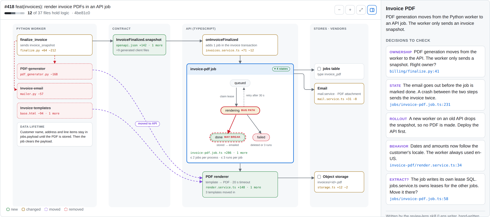
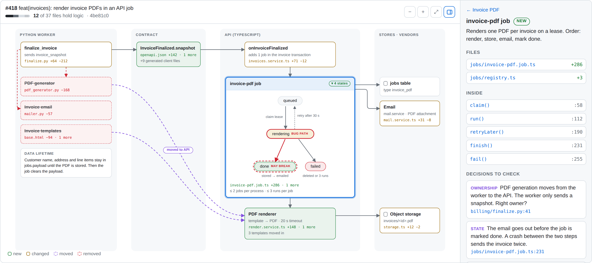
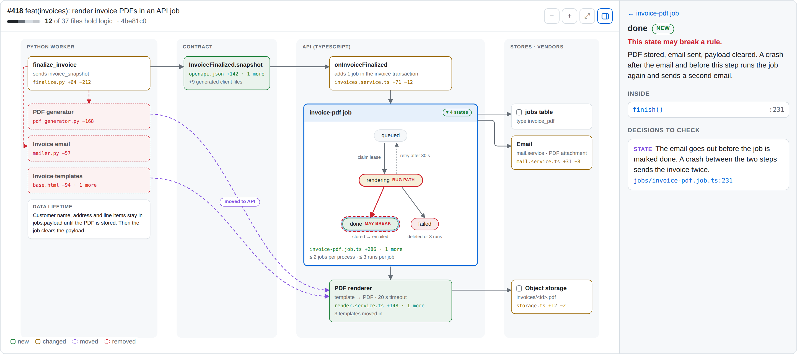
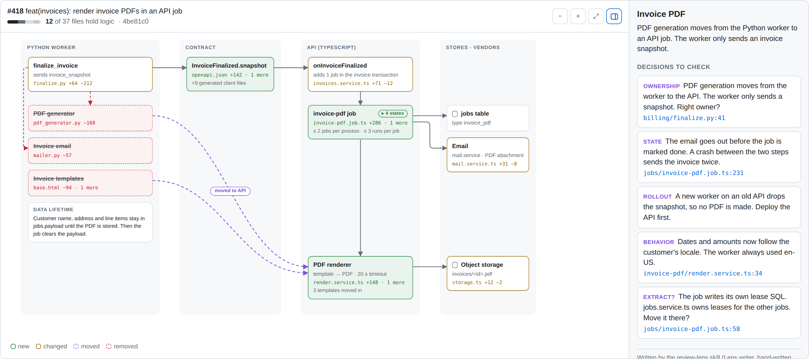

# review-lens

review-lens turns an AI-written PR review into a visual lens: one HTML page that shows the PR as lanes, cards, edges, state machines, notes, and decisions to check.



## Why

AI writes a lot of code fast. Line-by-line review does not show where logic moved, which states a job can reach, or where personal data is stored. A lens shows that first:

- **Structure.** Lanes are packages or layers. A card is one unit of logic with its files and `+`/`−` counts. Removed logic is dashed and struck through. Moved logic has a purple curve.
- **States.** A card can hold a state machine that opens in place. States that can break a rule are marked, with the path to them.
- **Data flow.** Edges show calls and data. A note says how long sensitive data lives.
- **Decisions.** The sidebar lists the design questions for the owner, each linked to the line on GitHub.

The model that reviews the PR writes only semantic JSON. It never gives coordinates. A deterministic layout computes the positions, and a small renderer draws HTML cards and SVG edges. The model does not need to render, look, and fix a drawing.

## Quick start

You need Node 24 and pnpm 12.

```sh
pnpm install
pnpm build
pnpm review-lens html examples/invoice-pdf/lens.json -o /tmp/lens.html
```

Open `/tmp/lens.html` in a browser. Click a card or a state to see its files, functions, and decisions. Click the chip on a card to open or close its state machine. Use ctrl or ⌘ with the mouse wheel to zoom, and drag to pan.

The example describes a fictional app, so its GitHub links do not resolve.

## Review flow

1. **Facts.** Read the diff numbers and classify the files:

   ```sh
   pnpm review-lens facts --base origin/main --head HEAD --cwd /path/to/repo -o facts.json
   ```

2. **Lens writer.** An AI model reads the diff, `facts.json`, and the code, and writes `lens.json`. The instructions are in [the review-lens skill](.agents/skills/review-lens/SKILL.md) and [the drawing guide](.agents/skills/review-lens/references/drawing-guide.md).
3. **Check.** Validate the lens against the schema and the facts. The command exits with 1 on errors.

   ```sh
   pnpm review-lens check lens.json --facts facts.json
   ```

4. **HTML.** Build one self-contained page. Errors stop the build.

   ```sh
   pnpm review-lens html lens.json --facts facts.json -o lens.html
   ```

5. **Show.** Open the page in a browser, or show it in T3 Code. The page uses the T3 Code theme variables when they exist, so it follows light and dark mode there. In a browser it uses a light theme.

## Screenshots

| A card selected | A state selected | State machine closed |
| --- | --- | --- |
|  |  |  |

## Artifact format

See [the artifact format](.agents/skills/review-lens/references/artifact-format.md) and the schema in [src/packages/schema](src/packages/schema/src/index.ts).

## Packages

| Path | Package |
| --- | --- |
| `src/packages/schema` | `@review-lens/schema`: Zod schema and types of the lens and the facts |
| `src/packages/layout` | `@review-lens/layout`: pure layout, no DOM |
| `src/packages/check` | `@review-lens/check`: validation |
| `src/apps/viewer` | `@review-lens/viewer`: the browser viewer, built into one HTML template |
| `src/apps/cli` | `@review-lens/cli`: the `review-lens` command |

Commands: `pnpm lint`, `pnpm typecheck`, `pnpm test`, `pnpm build`. `pnpm check` formats and fixes files.

To update the screenshots, build the example page, then run `PUPPETEER_MODULE=/path/to/node_modules/puppeteer pnpm screenshots`.

## Credits

The drawing guide adapts rules from the pstack skills `statechart`, `teach`, `ketchup`, and `how` in [cursor/plugins, harness/pstack](https://github.com/cursor/plugins/tree/main/harness/pstack) (MIT).

## License

[MIT](LICENSE)
